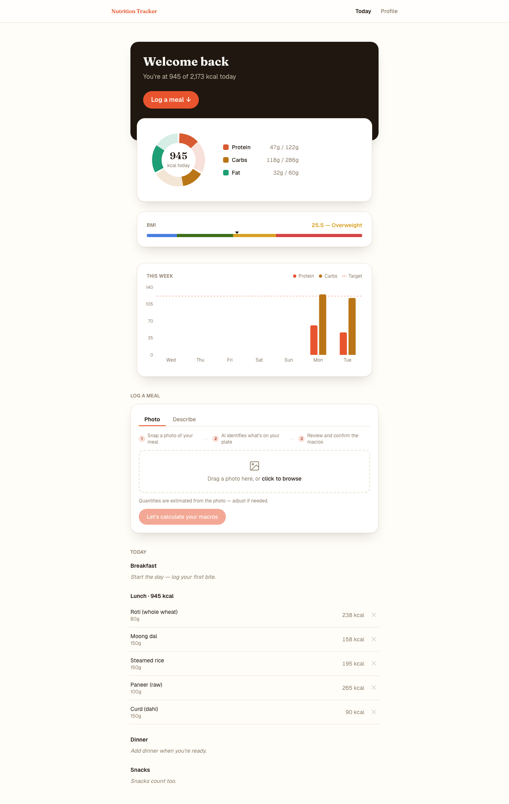
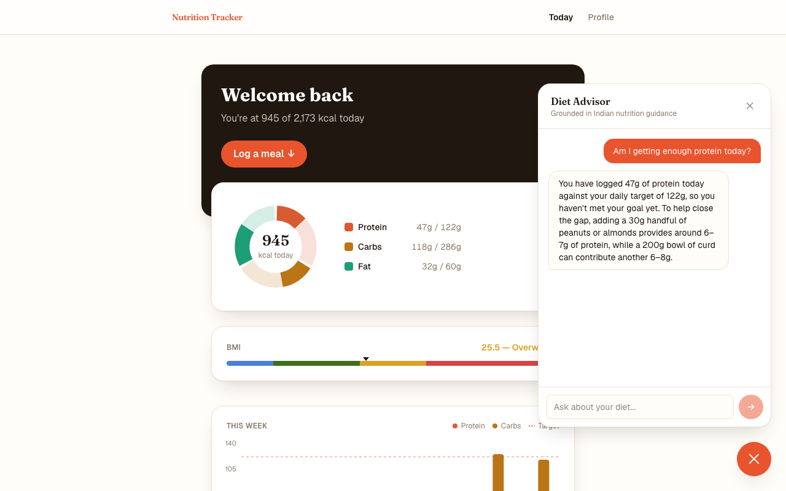
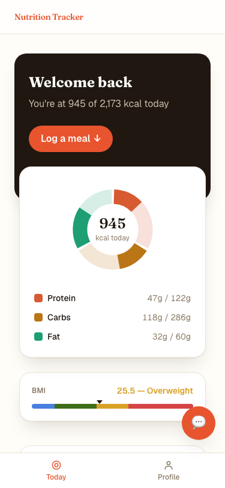
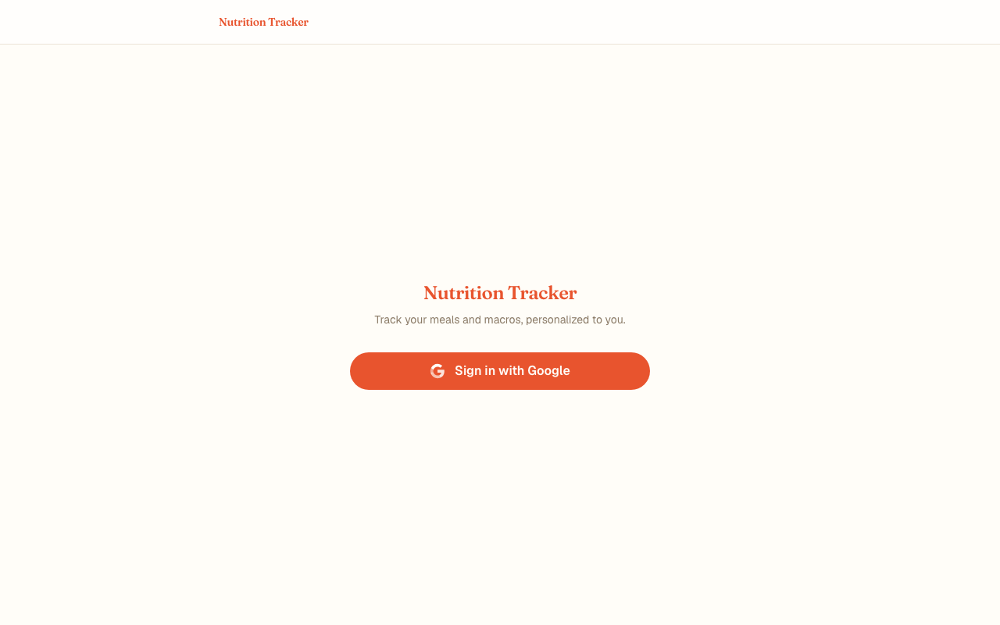
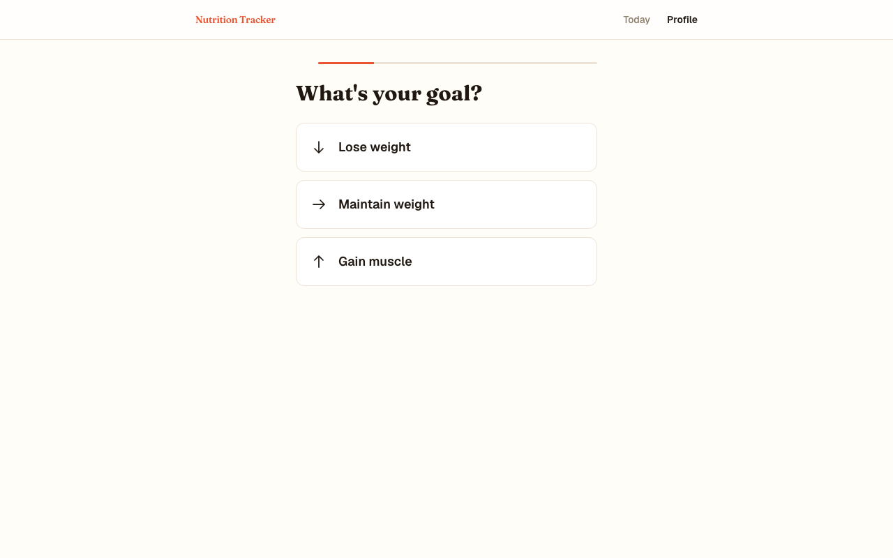
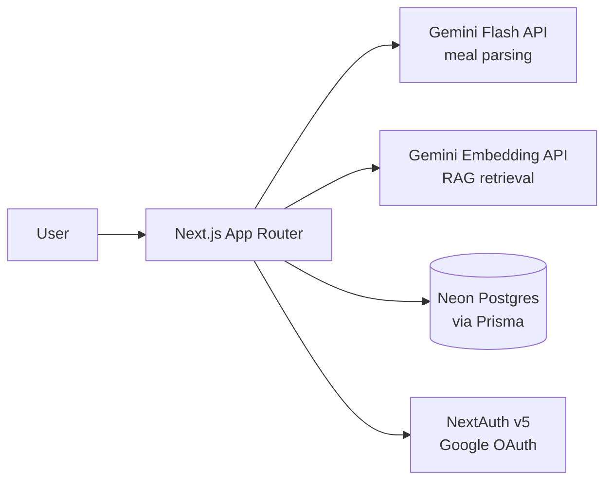

# Macroly

An India-first AI nutrition tracker that solves the protein gap in Indian diets.

**Live app:** [nutrition-app-delta-tawny.vercel.app](https://nutrition-app-delta-tawny.vercel.app)

## The Problem

Indian diets are typically 60-70% carbohydrate, with protein intake well below ICMR-NIN's recommended daily allowance — a pattern driven by rice/roti forming the base of nearly every meal. Mainstream trackers like MyFitnessPal and HealthifyMe have thin Indian food coverage and don't surface this pattern at all. Vegetarians are hit hardest: protein sources are limited to dal, paneer, and curd, and there's no good tool for tracking against Indian-specific dietary guidelines rather than generic Western macro targets.

## What This App Does

- AI-powered meal logging via text description or photo (Gemini Flash)
- 79-item Indian food database sourced from IFCT, with Hindi alias matching (dahi → curd, chawal → rice)
- Falls back to AI-estimated macros when a logged food isn't in the database, instead of dead-ending
- RAG-powered diet advisor grounded in ICMR-NIN nutritional guidelines — 56 curated knowledge chunks, retrieved via in-memory cosine similarity
- Personalized daily calorie/macro targets based on BMI, activity level, and goal (lose/maintain/gain)
- Weekly protein-vs-carb trend chart to visualize the core dietary pattern over time
- Multi-user auth via Google OAuth (NextAuth v5) — independent profiles and meal history per user

## Screenshots

| Dashboard | Diet Advisor | Mobile |
|-----------|-------------|--------|
|  |  |  |

<details>
<summary>More screenshots</summary>

### Login


### Onboarding


</details>

## Architecture



## Tech Stack

- **Next.js 16** (App Router, TypeScript)
- **Tailwind CSS**
- **Prisma** + **Neon Postgres**
- **Gemini API** — Flash for meal parsing & advisor answers, embeddings for RAG
- **NextAuth v5** with Google OAuth
- **Vercel** (deployment)

## Key Technical Decisions

- **In-memory cosine similarity over a vector DB** (Pinecone/ChromaDB) — at 56 knowledge chunks, the infrastructure overhead isn't justified. At scale, I'd move to pgvector.
- **RAG over direct prompting for diet advice** — grounding responses in verified ICMR-NIN content prevents the model from hallucinating specific nutritional claims.
- **AI-estimated macro fallback over strict database matching** — real meals always include foods outside any fixed database, so the app estimates via Gemini and lets the user accept the estimate rather than dead-ending on "not found."
- **Client-side timezone detection with an IST server fallback** — the target audience is India-based, but the greeting still renders correctly for anyone regardless of timezone.

## Getting Started

**Prerequisites:** Node.js 18+, a Neon (or any) Postgres database, a Gemini API key, Google OAuth credentials.

```bash
git clone <repo-url>
cd nutrition-app
npm install
```

Set up environment variables — `.env`:

```
DATABASE_URL=
GEMINI_API_KEY=
```

`.env.local`:

```
NEXTAUTH_URL=
NEXTAUTH_SECRET=
GOOGLE_CLIENT_ID=
GOOGLE_CLIENT_SECRET=
```

Then:

```bash
npx prisma migrate dev
npx prisma db seed
npm run seed:embeddings   # computes RAG knowledge-base embeddings
npm run dev
```

Open [http://localhost:3000](http://localhost:3000).
